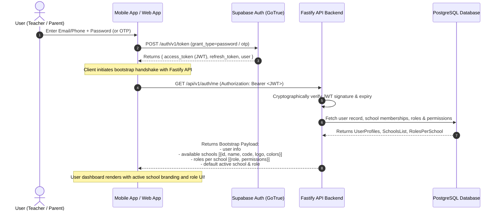

# CodeNCampus — Authentication and Authorization Specification

**Document Version:** 1.0.0  
**Status:** Under Architectural Review  
**Author:** Principal Security Engineer & Full-Stack Architect  
**Owner:** Codazk Technologies Private Limited

---

## 1. Authentication Strategy

CodeNCampus employs **Supabase Auth** as the managed identity provider for authentication primitives (credential storage, password hashing with Argon2id/Bcrypt, email confirmation, and mobile OTP delivery), coupled with an **authoritative, stateless Fastify backend** that performs cryptographically secure JWT verification, tenant membership validation, and fine-grained permission enforcement.

### 1.1 Key Principles

1. **Zero Trust on Frontend Claims:** Client apps (Web and Mobile) NEVER dictate their own permissions, school boundaries, or roles. The Fastify backend evaluates authorization on every API request directly from the database and validated cryptographic tokens.
2. **Stateless JWT Verification:** Fastify verifies Supabase-issued JWTs using Supabase's public JWKS or HMAC secret (`SUPABASE_JWT_SECRET`) without making an external HTTP round-trip to Supabase on every request.
3. **Multi-Role Single Identity:** A single human user (e.g., Jane Doe with phone `+91-9876543210`) has one internal `users.id` in the system, but can hold distinct roles in the same school (e.g., Teacher in Section 5A and Parent of a child in Nursery).
4. **Active Tenant & Persona Context:** The client sends an `X-School-ID` and `X-Active-Role` header when switching views; the backend rigorously verifies whether that user is legally granted that role within that specific school before fulfilling the request.

---

## 2. Authentication Flow



---

## 3. Fastify JWT Verification & Auth Plugin

The Fastify server registers a custom `@codencampus/auth` plugin that hooks into `onRequest`:

```typescript
// apps/api/src/plugins/auth.ts
import fp from "fastify-plugin";
import { FastifyPluginAsync, FastifyRequest, FastifyReply } from "fastify";
import jwt from "jsonwebtoken";

export interface AuthenticatedUser {
  id: string; // Supabase user UUID
  email?: string;
  phone?: string;
}

export interface AuthenticatedContext {
  user: AuthenticatedUser;
  schoolId: string;
  role: string;
  permissions: Set<string>;
}

declare module "fastify" {
  interface FastifyRequest {
    auth?: AuthenticatedContext;
  }
}

export const authPlugin: FastifyPluginAsync = fp(async (fastify) => {
  const JWT_SECRET = process.env.SUPABASE_JWT_SECRET!;

  fastify.decorate(
    "authenticate",
    async (request: FastifyRequest, reply: FastifyReply) => {
      try {
        const authHeader = request.headers.authorization;
        if (!authHeader || !authHeader.startsWith("Bearer ")) {
          return reply.status(401).send({
            statusCode: 401,
            error: "Unauthorized",
            message: "Missing or malformed Authorization header.",
          });
        }

        const token = authHeader.substring(7);
        const decoded = jwt.verify(token, JWT_SECRET) as {
          sub: string;
          email?: string;
          phone?: string;
        };

        const schoolIdHeader = request.headers["x-school-id"] as string;
        const requestedRole = request.headers["x-active-role"] as string;

        if (!schoolIdHeader) {
          return reply.status(400).send({
            statusCode: 400,
            error: "Bad Request",
            message: "Missing mandatory X-School-ID header.",
          });
        }

        // Validate tenant membership & role directly against the database/cache
        const membership = await fastify.prisma.schoolMembership.findUnique({
          where: {
            schoolId_userId: {
              schoolId: schoolIdHeader,
              userId: decoded.sub,
            },
          },
          include: {
            school: { select: { status: true } },
          },
        });

        if (
          !membership ||
          membership.status !== "ACTIVE" ||
          membership.school.status !== "ACTIVE"
        ) {
          return reply.status(403).send({
            statusCode: 403,
            error: "Forbidden",
            message:
              "User does not hold an active membership in the designated school tenant.",
          });
        }

        // Fetch granted permissions for this user in this school
        const userRoles = await fastify.prisma.userRole.findMany({
          where: {
            userId: decoded.sub,
            schoolId: schoolIdHeader,
          },
          include: {
            role: {
              include: {
                rolePermissions: {
                  include: { permission: true },
                },
              },
            },
          },
        });

        const activeRoleRecord =
          userRoles.find((ur) => ur.role.name === requestedRole) ||
          userRoles[0];

        if (!activeRoleRecord) {
          return reply.status(403).send({
            statusCode: 403,
            error: "Forbidden",
            message: "User has no authorized role assigned in this tenant.",
          });
        }

        const permissionSet = new Set<string>();
        for (const rp of activeRoleRecord.role.rolePermissions) {
          permissionSet.add(rp.permission.code);
        }

        request.auth = {
          user: { id: decoded.sub, email: decoded.email, phone: decoded.phone },
          schoolId: schoolIdHeader,
          role: activeRoleRecord.role.name,
          permissions: permissionSet,
        };
      } catch (err) {
        return reply.status(401).send({
          statusCode: 401,
          error: "Unauthorized",
          message: "Invalid or expired session token.",
        });
      }
    },
  );
});
```

---

## 4. Permission-Based Authorization Guards

Instead of coarse-grained role checks (which break when schools define custom roles), route endpoints enforce **granular permission codes**:

```typescript
// apps/api/src/modules/attendance/attendance.routes.ts
import { FastifyPluginAsync } from "fastify";
import { requirePermission } from "../../middleware/rbac";
import { markAttendanceSchema } from "@codencampus/validators";

export const attendanceRoutes: FastifyPluginAsync = async (fastify) => {
  fastify.post(
    "/mark",
    {
      preHandler: [fastify.authenticate, requirePermission("attendance.mark")],
      schema: {
        body: markAttendanceSchema,
      },
    },
    async (request, reply) => {
      const { schoolId, user } = request.auth!;
      const result = await fastify.attendanceService.recordAttendance({
        schoolId,
        recordedBy: user.id,
        data: request.body,
      });
      return reply.status(200).send(result);
    },
  );
};
```

---

## 5. Granular Permission Catalog

| Module            | Permission Code         | Description                         | Default Roles Granted     |
| ----------------- | ----------------------- | ----------------------------------- | ------------------------- |
| **School Config** | `school.config.view`    | View school profile and branding    | Admin, Principal, Teacher |
|                   | `school.config.update`  | Modify branding, terms, timings     | School Admin              |
| **Students**      | `students.create`       | Enroll new student                  | Admin                     |
|                   | `students.view`         | View full student profile & history | Admin, Principal, Teacher |
|                   | `students.update`       | Edit student demographic records    | Admin                     |
| **Attendance**    | `attendance.mark`       | Submit daily / period attendance    | Teacher, Admin            |
|                   | `attendance.view.class` | View attendance for class           | Teacher, Principal, Admin |
|                   | `attendance.view.self`  | View own/child attendance           | Student, Parent           |
| **Exams & Marks** | `marks.entry`           | Input student marks                 | Teacher                   |
|                   | `marks.publish`         | Finalize & publish exam results     | Principal, Admin          |
|                   | `marks.view.self`       | View own / child marks              | Student, Parent           |
| **Fees**          | `fees.structure.manage` | Create fee heads & structures       | School Admin              |
|                   | `fees.collect`          | Collect manual fees & record PG     | Accountant, School Admin  |
|                   | `fees.waive`            | Grant discounts & waivers           | Principal, School Admin   |
|                   | `fees.view.self`        | View invoices & pay online          | Parent                    |

---

## 6. Multi-Role Personas & Seamless Switching

### 6.1 Use Case Scenario

A single user, _Anjali Sharma_:

- Is an English Teacher in Class 9-A (`DPS-TCH-00104`).
- Is also the Mother of a student in Class 2-B (`DPS-PAR-00219`).

### 6.2 UX & State Implementation

1. **Mobile State Store (Zustand):**
   ```typescript
   interface SessionState {
     activeSchool: SchoolSummary;
     activeRole: "TEACHER" | "PARENT" | "STUDENT" | "ADMIN" | "PRINCIPAL";
     availableRoles: string[];
     setActiveRole: (role: string) => void;
   }
   ```
2. **Context Switching:**
   When Anjali taps "Switch to Parent View", the mobile app updates its Zustand state and attaches `X-Active-Role: PARENT` to subsequent HTTP calls.
3. **Backend Safety:**
   The backend independently checks the `user_roles` join table. Even if a compromised client sends `X-Active-Role: PRINCIPAL`, the backend detects that no such role is mapped to Anjali in that school and throws HTTP 403 Forbidden.

---

## 7. Security Hardening & Session Lifecycle

1. **Refresh Token Rotation:** Handled transparently by Supabase Auth with single-use refresh tokens to mitigate token theft.
2. **Brute-Force & Rate Limiting:**
   - Fastify `@fastify/rate-limit` enforces 5 failed login attempts per IP per 15 minutes on authentication endpoints.
   - SMS OTP endpoints capped at 3 requests per phone per 10 minutes to prevent SMS pumping attacks.
3. **Instant Session Revocation:**
   - If an employee is terminated or a student transferred, updating `school_memberships.status = 'SUSPENDED'` instantly terminates access on the subsequent API call, without needing to wait for JWT expiration.
