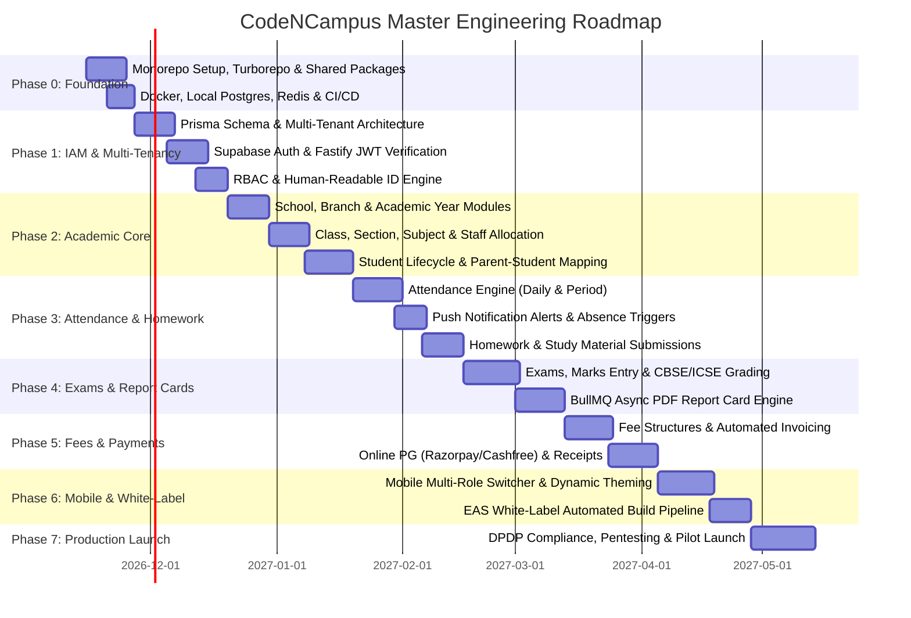

# CodeNCampus — Phased Development Roadmap & Execution Plan

**Document Version:** 1.0.0  
**Status:** Under Architectural Review  
**Author:** Principal Software Architect & Technical Lead  
**Owner:** Codazk Technologies Private Limited

---

## 1. Roadmap Philosophy & Phasing Strategy

Building a commercial, multi-tenant school operating system requires balancing comprehensive scope with disciplined execution. We strictly reject the "build everything at once" anti-pattern. Instead, we execute in **tight, testable, verifiable phases**.

Each phase produces a production-grade vertical slice with automated tests, TypeScript validation, and working database migrations before proceeding to subsequent modules.

---

## 2. Phase-by-Phase Execution Details

### Phase 0: Monorepo Foundation & Tooling (Sprint 1)

- **Deliverables:**
  1. Turborepo + `pnpm` workspaces initialized.
  2. Workspace packages configured:
     - `packages/database` (Prisma ORM, connection pool, seed scripts).
     - `packages/types` (Shared domain interfaces and DTOs).
     - `packages/validators` (Shared Zod schemas).
     - `packages/config` (Unified ESLint, Prettier, TypeScript presets).
  3. Base applications scaffolds:
     - `apps/api` (Fastify with Pino logger, health checks).
     - `apps/web` (Next.js 15 App Router with Tailwind CSS).
     - `apps/mobile` (Expo React Native with Expo Router).
  4. Docker Compose environment for local PostgreSQL 16 and Redis 7.
  5. GitHub Actions workflow for linting, typechecking, and unit tests on every pull request.
- **Verification Criteria:**
  `pnpm build`, `pnpm lint`, and `pnpm test` pass across all packages in < 45 seconds with 0 warnings.

---

### Phase 1: Authentication, Tenant Scoping & Identity Engine (Sprint 2 - 3)

- **Deliverables:**
  1. Complete PostgreSQL DDL migrations for organizations, schools, users, school memberships, roles, and permissions.
  2. Extended Prisma Client with automatic tenant scoping (`createTenantPrismaClient`).
  3. Fastify `@codencampus/auth` plugin:
     - Stateless Supabase JWT signature verification.
     - Extraction and validation of active `X-School-ID` and `X-Active-Role`.
     - Rejection of cross-tenant tokens.
  4. Server-side atomic readable ID generator (`tenant_sequences`) with zero concurrency collisions.
  5. User profile services: Students, Parents, and Staff/Teachers.
- **Verification Criteria:**
  Automated integration tests validating:
  - User cannot query School B with School A's authenticated session.
  - Multi-role user can switch persona without privilege escalation.
  - Concurrent student enrollment correctly generates sequential readable IDs (`DPS-STU-00001`, `00002`).

---

### Phase 2: School Structure & Academic Core (Sprint 4 - 5)

- **Deliverables:**
  1. School settings & configuration module (logo upload via S3 presigned URLs, theme colors, board selection).
  2. Academic Years & Terms management (calendar setup, current year flag).
  3. Classes, Sections, and Subjects management.
  4. Staff & Teacher directory: employee codes, designations, class-teacher allocations.
  5. Student admission workflow: intake form, emergency details, document uploads.
  6. Parent-Student link module: multiple children mapped to single parent account; primary contact flags.
- **Verification Criteria:**
  Admin web portal can successfully onboard a full grade level (e.g., Class 10 with sections A, B, C) and enroll 100 students mapped to parents.

---

### Phase 3: Daily Academic Operations (Sprint 6 - 7)

- **Deliverables:**
  1. Daily attendance engine (optimized batch update endpoint for 50+ students in one transaction).
  2. Attendance status tracking: Present, Absent, Half-Day, Late, Leave.
  3. BullMQ background job: Automated notification queue on student absence (Push notification + SMS trigger).
  4. Homework module: Teacher creates assignment with PDF/image attachments; students view due dates and submit work.
  5. Class noticeboard & circulars with delivery receipts.
- **Verification Criteria:**
  Teacher marks attendance for 45 students on mobile in < 2 seconds; absence push notifications delivered to parent test devices within 5 seconds.

---

### Phase 4: Examination, Marks & Report Cards (Sprint 8 - 9)

- **Deliverables:**
  1. Exam scheduler: Unit tests, term exams, subject-wise max marks and weightage.
  2. Marks entry interface (with validation against maximum marks and absent flags).
  3. Grading Engine:
     - CBSE 9-point scale (`A1` to `E`).
     - ICSE percentage and internal assessment weightage.
     - Custom State Board grading formulas.
  4. Asynchronous PDF Report Card generation service via BullMQ worker.
  5. Report card download and publication lock (prevent modifications after publication).
- **Verification Criteria:**
  Batch generation of 500 CBSE-compliant report card PDFs completes in background worker and uploads to private S3 bucket with signed download links.

---

### Phase 5: Administration, Fees & Financial Collections (Sprint 10 - 11)

- **Deliverables:**
  1. Fee Head and Fee Structure master (Tuition, Transport, Lab, Annual).
  2. Student fee assignment with custom scholarship / sibling discount waivers.
  3. Automated periodic invoice generation engine.
  4. Payment Gateway integration:
     - Razorpay & Cashfree webhooks with HMAC signature verification.
     - Instant idempotent invoice reconciliation.
  5. Counter collection module (Cash, Cheque, Bank Transfer) with atomic digital receipt generation.
  6. Financial audit logs and defaulter reports.
- **Verification Criteria:**
  Simulated payment gateway webhook idempotency test: duplicate webhooks do not double-record payment or issue duplicate receipts.

---

### Phase 6: Mobile Experience & White-Label Build Pipeline (Sprint 12 - 13)

- **Deliverables:**
  1. Mobile App Dashboards tailored for Student, Parent, Teacher, and School Admin personas.
  2. Parent multi-child switcher and rapid fee payment screen.
  3. Dynamic runtime theming in mobile app powered by Zustand store.
  4. White-label build matrix configuration (`app.config.ts`, `eas.json`, `tenants.config.json`).
  5. GitHub Actions workflow generating standalone `.aab` / `.ipa` builds for pilot schools.
- **Verification Criteria:**
  Triggering `APP_TENANT=dpsrkp` produces an Android APK with DPS logo, package identifier `com.codencampus.dpsrkp`, and green color palette.

---

### Phase 7: Production Hardening, Compliance & Commercial Launch (Sprint 14)

- **Deliverables:**
  1. DPDP Act (India) compliance audit: Parental consent logging, encryption of Aadhaar numbers, data deletion workflow.
  2. Security penetration testing & vulnerability scanning (OWASP Top 10, IDOR checks, rate-limit stress testing).
  3. Production AWS ECS Fargate & RDS Multi-AZ deployment.
  4. Sentry alerting & AWS CloudWatch dashboards configured.
  5. Onboarding of first 3 commercial pilot schools.
- **Verification Criteria:**
  Independent security checklist signed off; 99.9% uptime maintained during 30-day pilot run.
