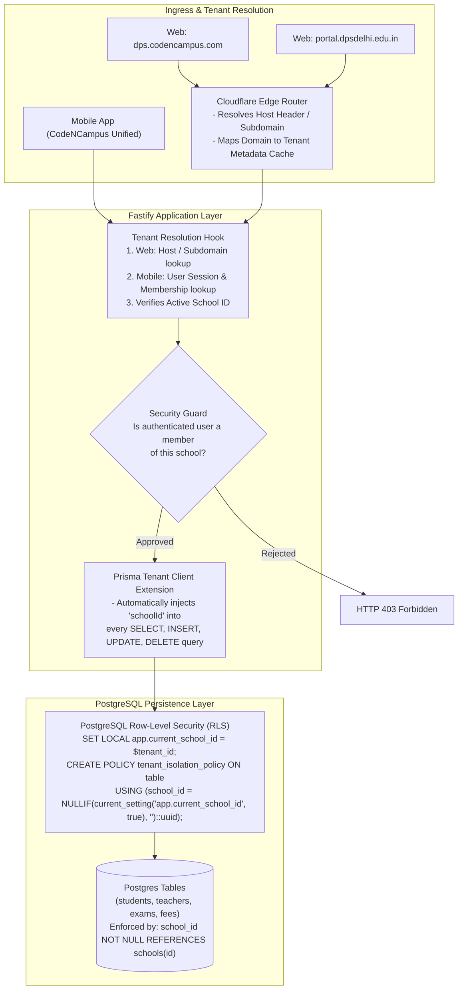

# CodeNCampus — Multi-Tenant Architecture & Data Isolation Model

**Document Version:** 1.0.0  
**Status:** Under Architectural Review  
**Author:** Principal Software Architect & Database Security Lead  
**Owner:** Codazk Technologies Private Limited

---

## 1. Architectural Strategy & Model Comparison

When designing a commercial B2B SaaS platform for hundreds or thousands of schools, choosing the correct tenant isolation pattern determines infrastructure cost, operational maintainability, migration complexity, and security posture.

| Model                                                              | Description                                                                                                                                                  | Pros                                                                                                                             | Cons                                                                                                                                  | Decision for CodeNCampus                                                 |
| ------------------------------------------------------------------ | ------------------------------------------------------------------------------------------------------------------------------------------------------------ | -------------------------------------------------------------------------------------------------------------------------------- | ------------------------------------------------------------------------------------------------------------------------------------- | ------------------------------------------------------------------------ |
| **Database per Tenant**                                            | Separate physical/logical DB for each school.                                                                                                                | Absolute physical isolation; easy single-tenant backup.                                                                          | Devastating infrastructure costs at 500+ schools; high connection pool exhaustion; complex migrations across hundreds of DBs.         | **Rejected** (Too cost-prohibitive and unmanageable for a growing SaaS). |
| **Schema per Tenant**                                              | Shared DB, distinct PostgreSQL schema per school.                                                                                                            | Good isolation; shared DB connections.                                                                                           | Prisma migrations become sluggish across thousands of schemas; Postgres table cache memory limits; cross-tenant reporting is painful. | **Rejected** (High maintenance overhead).                                |
| **Shared Database, Shared Schema with Defense-in-Depth Isolation** | Single unified database with `school_id` tenant discriminator, composite indexes, Prisma Tenant Scoping Extensions, and PostgreSQL Row-Level Security (RLS). | Maximum cost efficiency; simplified unified migrations; scales effortlessly to thousands of schools; optimal connection pooling. | Requires rigorous, automated tenant filtering at application and database layers.                                                     | **SELECTED (Industry Standard for Enterprise B2B SaaS)**                 |

---

## 2. Multi-Tenant Architecture Overview



---

## 3. Tenant Resolution Mechanisms

### 3.1 Web Portal Tenant Resolution (Subdomains & Custom Domains)

1. **Subdomain Extraction:**
   - When a request hits `dpsrkp.codencampus.com`, the Cloudflare edge or Fastify reverse proxy parses the hostname (`dpsrkp`).
   - Fastify checks Redis for cached school metadata:
     `school:slug:dpsrkp -> { id: "a1b2...", name: "DPS R.K. Puram", status: "ACTIVE" }`.
   - If not in cache, Fastify queries `schools` table and warms the cache (TTL: 1 hour).
2. **Custom Domain Routing:**
   - Elite schools using `portal.dpsdelhi.edu.in` have a CNAME pointing to `proxy.codencampus.com`.
   - Cloudflare for SaaS (SSL for SaaS) dynamically terminates SSL and forwards the `Host` header.
   - Fastify resolves `schools.custom_domain = 'portal.dpsdelhi.edu.in'`.

### 3.2 Mobile Application Tenant Resolution

1. **Initial Login:**
   - User enters their mobile number / email.
   - Fastify returns the list of schools where this user holds an active membership.
   - If user has 1 school (e.g., DPS RKP), that school is pre-selected.
   - If user is associated with multiple schools (e.g., parent with children in two separate schools), a school selector card is presented.
2. **Subsequent API Calls:**
   - Mobile sends `X-School-ID: <uuid>` on all authenticated API requests.
   - Backend validates the token's `sub` holds an active membership in `<uuid>`.

---

## 4. Defense-in-Depth Tenant Isolation Layers

Never rely on a single defensive layer. CodeNCampus enforces **Three Concentric Rings of Tenant Isolation**:

### Layer 1: Fastify Route Pre-Handler Guard (Gateway Layer)

Every tenant-scoped route executes an isolation pre-handler:

```typescript
// apps/api/src/middleware/tenantGuard.ts
export async function tenantGuard(
  request: FastifyRequest,
  reply: FastifyReply,
) {
  const { user, schoolId } = request.auth!;

  // Double check user membership in the targeted school tenant
  const isMember = await request.server.prisma.schoolMembership.findFirst({
    where: {
      schoolId: schoolId,
      userId: user.id,
      status: "ACTIVE",
    },
    select: { id: true },
  });

  if (!isMember) {
    request.log.warn({
      msg: "Cross-tenant access attempt detected!",
      userId: user.id,
      attemptedSchoolId: schoolId,
    });
    return reply.status(403).send({
      statusCode: 403,
      error: "Forbidden",
      message:
        "Access denied: You are not authorized to access this institution data.",
    });
  }
}
```

### Layer 2: Extended Prisma Client (Application ORM Layer)

Developers NEVER write raw WHERE clauses like `where: { id: studentId }`. All queries pass through `createTenantPrismaClient(schoolId)`:

- Even if a developer accidentally forgets to write `schoolId: ...`, the Prisma extension intercepts the AST and automatically injects `where: { schoolId: activeSchoolId }`.
- Creates automatically assign `data: { ...data, schoolId: activeSchoolId }`.

### Layer 3: PostgreSQL Row-Level Security (RLS) (Database Kernel Layer)

As the ultimate fail-safe against zero-day ORM bugs or developer error, PostgreSQL Row-Level Security is active on all core tables:

```sql
-- Enable RLS on sensitive tables
ALTER TABLE students ENABLE ROW LEVEL SECURITY;
ALTER TABLE exam_marks ENABLE ROW LEVEL SECURITY;
ALTER TABLE fee_invoices ENABLE ROW LEVEL SECURITY;
ALTER TABLE attendance_records ENABLE ROW LEVEL SECURITY;

-- Define Tenant Policy
CREATE POLICY tenant_isolation_policy ON students
    FOR ALL
    USING (school_id = NULLIF(current_setting('app.current_school_id', true), '')::uuid);

CREATE POLICY tenant_isolation_policy ON exam_marks
    FOR ALL
    USING (school_id = NULLIF(current_setting('app.current_school_id', true), '')::uuid);

CREATE POLICY tenant_isolation_policy ON fee_invoices
    FOR ALL
    USING (school_id = NULLIF(current_setting('app.current_school_id', true), '')::uuid);
```

When checking out a database connection from the pool, Fastify sets the local session variable:

```sql
SET LOCAL app.current_school_id = 'a1b2c3d4-e5f6-7890-abcd-ef1234567890';
```

Any accidental query attempting to access School B's rows while `app.current_school_id` is set to School A returns `0 rows`, guaranteeing zero data leakage even in raw SQL scenarios.

---

## 5. Preventing Insecure Direct Object References (IDOR)

Common SaaS security flaw: An attacker logs in as School A, changes the URL parameter from `GET /api/v1/students/student-uuid-A` to `GET /api/v1/students/student-uuid-B`.

### CodeNCampus Safeguard:

All single-entity queries enforce composite lookup by ID and Tenant:

```typescript
// Safe implementation
const student = await db.student.findFirst({
  where: {
    id: studentId,
    schoolId: request.auth.schoolId, // Always constrained
  },
});

if (!student) {
  // Return 404 instead of 403 to prevent ID enumeration
  return reply.status(404).send({ error: "Student not found." });
}
```

---

## 6. Multi-Tenant File Storage Isolation (AWS S3)

Files (student transfer certificates, homework attachments, mark sheets) are strictly isolated using scoped S3 prefixes:

```
s3://codencampus-assets-prod/
├── tenants/
│   ├── {school_id}/
│   │   ├── branding/
│   │   │   ├── logo.png
│   │   │   └── banner.jpg
│   │   ├── students/
│   │   │   └── {student_id}/
│   │   │       ├── avatar.jpg
│   │   │       └── documents/
│   │   │           └── birth_certificate.pdf
│   │   ├── homework/
│   │   └── invoices/
```

- Uploads occur via **Pre-Signed S3 URLs** generated exclusively by the Fastify API.
- The Fastify backend validates that the uploading user belongs to the target `school_id` before issuing a presigned upload URL for that school's specific prefix.
- Direct public listing on S3 buckets is disabled. Private student documents are accessed only via short-lived (15-minute) presigned download URLs.
