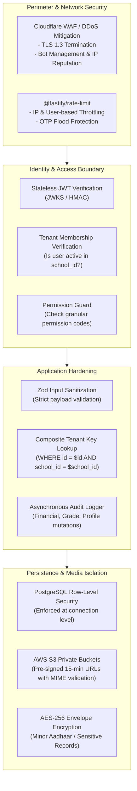
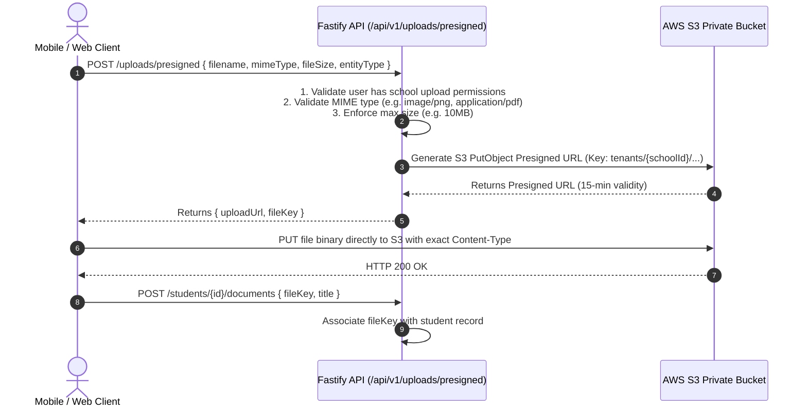

# CodeNCampus — Security, Compliance & Data Protection Specification

**Document Version:** 1.0.0  
**Status:** Under Architectural Review  
**Author:** Principal Security Engineer & Infrastructure Architect  
**Owner:** Codazk Technologies Private Limited

---

## 1. Security Architecture & Threat Model

CodeNCampus operates in an educational ecosystem dealing with minor children's data, financial transactions, and proprietary institutional records. Security is not an afterthought; it is built into the foundation at every layer.



---

## 2. Threat Mitigation Matrix (OWASP Top 10)

| Vulnerability Category                               | Risk Scenario in School SaaS                                                                             | CodeNCampus Mitigation Architecture                                                                                                                                                                                                                 |
| ---------------------------------------------------- | -------------------------------------------------------------------------------------------------------- | --------------------------------------------------------------------------------------------------------------------------------------------------------------------------------------------------------------------------------------------------- |
| **A01: Broken Access Control (IDOR & Tenant Bleed)** | Teacher in School A modifies marks of a student in School B by manipulating `student_id` in API payload. | **1.** Fastify `tenantGuard` verifies school membership.<br/>**2.** Prisma Client Extension enforces `school_id` scoping on every query.<br/>**3.** PostgreSQL Row-Level Security prevents cross-tenant reads even in raw SQL.                      |
| **A02: Cryptographic Failures**                      | Minor's Aadhaar numbers, parent bank details, or passwords leaked in plaintext backups.                  | **1.** Passwords hashed via Supabase Auth (Argon2id/Bcrypt).<br/>**2.** Sensitive national IDs encrypted at rest using AES-256-GCM envelope encryption.<br/>**3.** TLS 1.3 enforced for all transport traffic.                                      |
| **A03: Injection (SQL, XSS, Command)**               | Malicious student names or search inputs injected into database queries or web portals.                  | **1.** 100% Parameterized queries via Prisma ORM (prepared statements).<br/>**2.** React and React Native automatically escape JSX variables preventing XSS.<br/>**3.** Strict Content Security Policy (CSP) headers applied via `@fastify/helmet`. |
| **A04: Insecure Design**                             | Absence of rate limiting allows attackers to exhaust SMS gateway credits via OTP bombing.                | **1.** Fastify rate limit caps OTP requests to 3 per 10 minutes per mobile number.<br/>**2.** Turnstile / CAPTCHA triggered on suspicious authentication attempts.                                                                                  |
| **A05: Security Misconfiguration**                   | Unhandled server exceptions leaking database connection strings or stack traces to clients.              | **1.** Centralized Fastify error handler catches all unhandled exceptions.<br/>**2.** Production responses return sanitized error codes; stack traces piped solely to Sentry and Pino structured logs.                                              |
| **A06: Vulnerable Components**                       | Outdated third-party npm libraries introducing CVEs.                                                     | **1.** Automated Dependabot & Snyk scanning in GitHub CI/CD.<br/>**2.** Zero tolerance for high/critical CVEs in production dependencies.                                                                                                           |
| **A07: Identification Failures**                     | Stolen JWT allows perpetual unauthorized access.                                                         | **1.** Short-lived access tokens (60 minutes).<br/>**2.** Single-use refresh token rotation.<br/>**3.** Immediate revocation on user suspension (`school_memberships.status = 'SUSPENDED'`).                                                        |

---

## 3. Regulatory Compliance: DPDP Act 2023 (India)

Under the **Digital Personal Data Protection Act (DPDP Act 2023)**, educational platforms processing personal data of children (below 18 years) are subject to stringent duties:

### 3.1 Verifiable Parental Consent (VPC)

- Student onboarding requires explicit digital consent from a parent or legal guardian.
- The system logs:
  - Timestamp of consent.
  - Guardian's verified mobile number (OTP verified).
  - Version of the Privacy Policy accepted.
  - IP address and user-agent.

### 3.2 Purpose Limitation & Data Minimization

- No behavioral tracking or targeted advertising is ever directed at students.
- Only academic, safety, and administrative data strictly necessary for school operations is collected.
- Student Aadhaar / national identity numbers are optional; when collected for government scholarships, they are stored encrypted using KMS-managed keys.

### 3.3 Right to Correction & Erasure (Data Portability)

- When a student departs the institution (Transfer Certificate issued), personal data is retained for the legally mandated period (academic records retention laws), after which parents can request erasure of non-statutory data.

---

## 4. Secure File Upload Architecture (S3 Presigned URLs)

Direct multipart file uploads to the Node.js API server are prohibited because they create denial-of-service risks (memory buffer exhaustion) and introduce malicious executable vulnerabilities.

### Upload Flow:



---

## 5. Audit Logging Architecture

Every mutation to sensitive institutional, financial, or academic records generates an immutable audit record:

### 5.1 Audited Actions

- `FEE_PAYMENT_COLLECTED`, `FEE_WAIVER_APPLIED`
- `EXAM_MARKS_MODIFIED`, `REPORT_CARD_PUBLISHED`
- `ATTENDANCE_OVERRIDDEN`
- `STUDENT_RECORD_DELETED`
- `ROLE_PERMISSION_CHANGED`

### 5.2 Audit Record Structure

```json
{
  "id": "c1f7a0b2-...",
  "schoolId": "a1b2c3d4-...",
  "userId": "u9x8y7...",
  "action": "EXAM_MARKS_MODIFIED",
  "entityName": "exam_marks",
  "entityId": "mark-uuid-556",
  "ipAddress": "203.0.113.195",
  "oldValues": { "marksObtained": 68.0, "grade": "B2" },
  "newValues": { "marksObtained": 82.0, "grade": "A2" },
  "createdAt": "2026-11-14T14:30:00.000Z"
}
```

Audit logs are written asynchronously via BullMQ to avoid adding latency to interactive user requests.

---

## 6. Secrets Management & Environment Hygiene

1. **Zero Secrets in Source Control:**
   - `.gitignore` strictly blocks all `.env*` files.
   - Pre-commit hooks (`git-secrets` / `trufflehog`) scan for accidental credential commits.
2. **Runtime Environment Validation:**
   - Both `apps/api` and `apps/web` validate environment variables at startup using strict Zod schemas. If any required secret (e.g., `DATABASE_URL`, `SUPABASE_JWT_SECRET`, `AWS_SECRET_ACCESS_KEY`) is missing or malformed, the process halts immediately with a clear error.
3. **No Private Keys on Client Devices:**
   - Supabase `service_role` keys, database connection strings, and payment gateway secret keys are NEVER deployed to the Next.js client bundle or Expo mobile application. Only public client tokens (`SUPABASE_ANON_KEY`, `EXPO_PUBLIC_API_URL`) are embedded in client apps.
