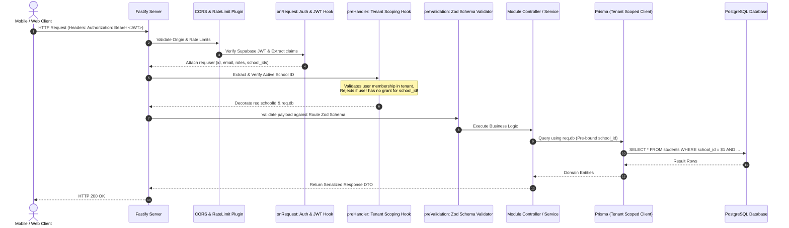
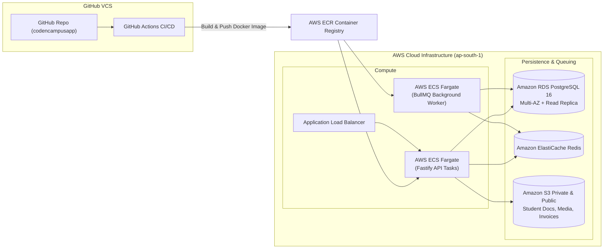

# CodeNCampus — System Architecture Document

**Document Version:** 1.0.0  
**Status:** Under Architectural Review  
**Author:** Principal Software Architect & DevOps Engineer  
**Owner:** Codazk Technologies Private Limited

---

## 1. High-Level System Architecture

CodeNCampus is structured as a **Multi-Tenant Modular Monolith** managed within a **Turborepo Monorepo**. This strikes an optimal balance between rapid solo-founder/lean-team velocity, strict domain boundaries, code reuse across Web and Mobile, and zero premature microservices complexity.

```mermaid
flowchart TD
    subgraph Clients["Clients Layer"]
        MobileApp["Mobile App (React Native / Expo)\n- Common App (Dynamic Theming)\n- White-label EAS Branded Builds"]
        WebAdmin["Web App (Next.js 15 App Router)\n- School Admin & Principal Console\n- Super Admin Console\n- Teacher Portal"]
    end

    subgraph Edge["Edge & Security Layer"]
        Cloudflare["Cloudflare CDN & WAF\n- DDoS Protection & SSL Termination\n- Custom Subdomain Routing (*.codencampus.com)"]
        S3Storage["AWS S3 + CloudFront CDN\n- School Logos, Homework, Docs\n- Presigned Upload URLs"]
    end

    subgraph Auth["Identity Provider"]
        SupabaseAuth["Supabase Auth / GoTrue\n- Email/Password, Mobile OTP\n- JWT Issuance"]
    end

    subgraph AppLayer["Application Layer (Backend Monolith)"]
        FastifyAPI["Fastify Backend API (Node.js + TypeScript)\n- Request Pipeline & Tenant Scoping Hook\n- JWT Verification & Role/Permission Check\n- Zod Input & Output Serialization\n- Modular Monolith Domain Engines"]

        subgraph DomainModules["Modular Monolith Domains"]
            SchoolDomain["School & Branch Module"]
            UserDomain["IAM & Profile Module"]
            AcademicDomain["Class, Section, Timetable Module"]
            AttendanceDomain["Attendance Engine"]
            ExamDomain["Exams & Grading Engine"]
            FeeDomain["Fees & Payments Engine"]
            CommsDomain["Notifications & Noticeboard"]
        end
    end

    subgraph Async["Background Workers & Jobs"]
        BullMQ["BullMQ Worker (Node.js)\n- Attendance SMS / Push Notifications\n- Report Card PDF Generation\n- Fee Due Reminders & Reconciliations"]
        Redis["Redis (Upstash / AWS ElastiCache)\n- BullMQ Job Queues\n- Rate Limiting & Session Caches"]
    end

    subgraph DataLayer["Persistence Layer"]
        Postgres[(AWS RDS PostgreSQL 16)\n- Multi-Tenant Isolated DB (Shared Schema)\n- Prisma ORM + Prepared Statements\n- Tenant Row-Level Security (RLS) & Indexed Queries]
    end

    Clients --> Cloudflare
    Cloudflare --> FastifyAPI
    Cloudflare --> WebAdmin
    Clients --> S3Storage
    Clients --> SupabaseAuth
    FastifyAPI --> SupabaseAuth
    FastifyAPI --> Redis
    FastifyAPI --> DomainModules
    DomainModules --> Postgres
    FastifyAPI --> BullMQ
    BullMQ --> Redis
    BullMQ --> Postgres
    BullMQ --> S3Storage
```

---

## 2. Monorepo Structure (Turborepo + pnpm)

The project leverages `pnpm` workspaces combined with `Turborepo` for blazingly fast incremental builds, shared packages, and unified type safety.

```
codencampusapp/
├── .github/
│   ├── workflows/
│   │   ├── ci.yml                 # Lint, TypeCheck, Unit Tests
│   │   ├── deploy-api.yml         # Fastify API Deployment (Docker / AWS ECS)
│   │   ├── deploy-web.yml         # Next.js Web Deployment
│   │   └── build-mobile.yml       # Expo EAS White-label Matrix Pipeline
├── apps/
│   ├── api/                       # Fastify Modular Monolith Backend
│   │   ├── src/
│   │   │   ├── config/            # Env schema (Zod), Logger (Pino)
│   │   │   ├── plugins/           # Fastify plugins (auth, prisma, tenant, ratelimit)
│   │   │   ├── modules/           # Domain-driven feature modules
│   │   │   │   ├── auth/          # JWT verification, RBAC mapping
│   │   │   │   ├── schools/       # Tenants, branding, branches
│   │   │   │   ├── users/         # Students, teachers, parents, staff
│   │   │   │   ├── academics/     # Classes, sections, subjects, timetables
│   │   │   │   ├── attendance/    # Daily & period attendance
│   │   │   │   ├── exams/         # Exams, marks, report cards
│   │   │   │   ├── fees/          # Fee heads, invoices, payment gateways
│   │   │   │   └── notifications/ # Push, WhatsApp, Email, SMS
│   │   │   ├── workers/           # BullMQ job consumers (PDF, notifications)
│   │   │   ├── app.ts             # Fastify instance builder
│   │   │   └── server.ts          # Process entry point & graceful shutdown
│   │   ├── Dockerfile
│   │   └── tsconfig.json
│   ├── web/                       # Next.js 15 (App Router) Web Portal
│   │   ├── src/
│   │   │   ├── app/               # (admin), (principal), (superadmin), (auth)
│   │   │   ├── components/        # Web UI components & layout shells
│   │   │   ├── hooks/             # Custom web hooks (React Query)
│   │   │   ├── lib/               # API clients, utils
│   │   │   └── styles/            # Tailwind CSS v4 / custom styles
│   │   ├── Dockerfile
│   │   └── tsconfig.json
│   └── mobile/                    # React Native / Expo Mobile App
│       ├── app/                   # Expo Router file-based routes
│       │   ├── (auth)/            # Login, forgot password, school lookup
│       │   ├── (student)/         # Student dashboard, timetable, homework
│       │   ├── (parent)/          # Multi-child switcher, attendance, fees
│       │   ├── (teacher)/         # Attendance marking, marks entry, notes
│       │   └── (admin)/           # Emergency notices, daily summaries
│       ├── src/
│       │   ├── components/        # Mobile UI primitives & compound widgets
│       │   ├── hooks/             # TanStack Query hooks, biometric auth
│       │   ├── store/             # Zustand stores (session, activeRole, theme)
│       │   └── theme/             # Dynamic runtime color provider
│       ├── app.config.ts          # Dynamic Expo config for white-labeling
│       ├── eas.json               # EAS Build configuration & profiles
│       └── tsconfig.json
├── packages/
│   ├── database/                  # Prisma ORM Schema, Migrations, Client
│   │   ├── prisma/
│   │   │   ├── schema.prisma
│   │   │   └── seed.ts
│   │   └── src/index.ts           # Extended Prisma Client with Tenant Scoping
│   ├── types/                     # Shared TypeScript interfaces & DTOs
│   │   └── src/index.ts
│   ├── validators/                # Shared Zod validation schemas (cross-app)
│   │   └── src/index.ts
│   ├── ui/                        # Shared UI tokens, primitives (Tailwind/RN)
│   ├── config/                    # Shared ESLint, Prettier, TSConfig presets
│   └── logger/                    # Shared structured logger
├── docs/                          # Master Architecture & Technical Specs
├── package.json                   # Root workspace config
├── pnpm-workspace.yaml            # Monorepo workspaces
├── turbo.json                     # Turborepo task pipeline cache definition
└── README.md
```

---

## 3. Backend Architecture: Modular Monolith (Fastify)

The backend avoids the operational latency, distributed transaction complexity, and network serialization overhead of microservices, while enforcing strict module encapsulation.

### 3.1 Fastify Request Lifecycle & Tenant Middleware

Every incoming request passes through an immutable pipeline:



### 3.2 Modular Monolith Domain Design Principles

1. **Zero Direct Cross-Module Database Table Coupling:** Module A never directly queries Module B's private tables. Instead, interactions occur through clean Domain Services or domain events.
2. **Explicit Dependency Injection:** Domain services receive their dependencies (database client, notification provider, logger) explicitly.
3. **Decoupled Asynchronous Events:** Cross-module side effects (e.g., student admission triggers fee invoice creation and parent SMS) are dispatched via BullMQ background jobs.

---

## 4. Web Application Architecture (Next.js)

The School Management Web Portal serves School Administrators, Principals, Accountants, and Teachers:

- **Framework:** Next.js 15 with App Router.
- **Rendering Strategy:**
  - Dynamic Server Rendering (SSR) for authenticated management dashboards ensuring zero stale authorization data.
  - Client Components only at the interaction leaf nodes (forms, interactive charts, data tables).
- **State & Data Fetching:**
  - TanStack Query (React Query) for client-side caching, background refetching, and optimistic mutations.
  - Server Actions used for lightweight mutations, guarded with session verification.
- **UI/UX Stack:**
  - Tailwind CSS for design-token compliance.
  - Radix UI primitives for accessible, WCAG-compliant dropdowns, modals, and date pickers.
  - Recharts for academic performance, fee recovery, and attendance dashboards.

---

## 5. Mobile Application Architecture (React Native + Expo)

- **Framework:** React Native with Expo (Managed Workflow with Prebuild support).
- **Navigation:** Expo Router (File-based, deeply typed navigation with instant deep-linking).
- **State Management:**
  - **Zustand:** Lightweight global stores for Authentication Token, Active School Tenant, Active Role Persona, and Theme Colors.
  - **TanStack Query:** Server state synchronization, offline cache persistence, and automated invalidation.
- **Form Handling:** React Hook Form coupled with Zod validation via `@hookform/resolvers/zod`.
- **Dynamic Theming System:** A central `ThemeProvider` that reads the authenticated tenant's primary/secondary hex colors and applies them dynamically to buttons, headers, accents, and charts.

---

## 6. Infrastructure, Background Jobs & DevOps



### 6.1 Background Processing (BullMQ + Redis)

Long-running and non-blocking tasks are immediately handed off to BullMQ queues:

- `pdf-generator`: Compiling CBSE-format term report cards and fee receipts using headless Puppeteer or `@react-pdf/renderer`.
- `notifications`: Dispatching batched push notifications (Firebase Cloud Messaging / Expo Push) and transactional WhatsApp/SMS messages.
- `audit-logger`: Asynchronously persisting audit trails for high-volume read/write actions.

### 6.2 Monitoring & Telemetry

- **Sentry:** Distributed tracing and real-time crash reporting across Web, Mobile, and Fastify backend.
- **Pino & AWS CloudWatch:** Structured JSON log outputs with correlated `requestId` and `schoolId` on every entry.
- **Health Checks:** `/healthz` (liveness probe) and `/readyz` (checks DB and Redis connectivity).
