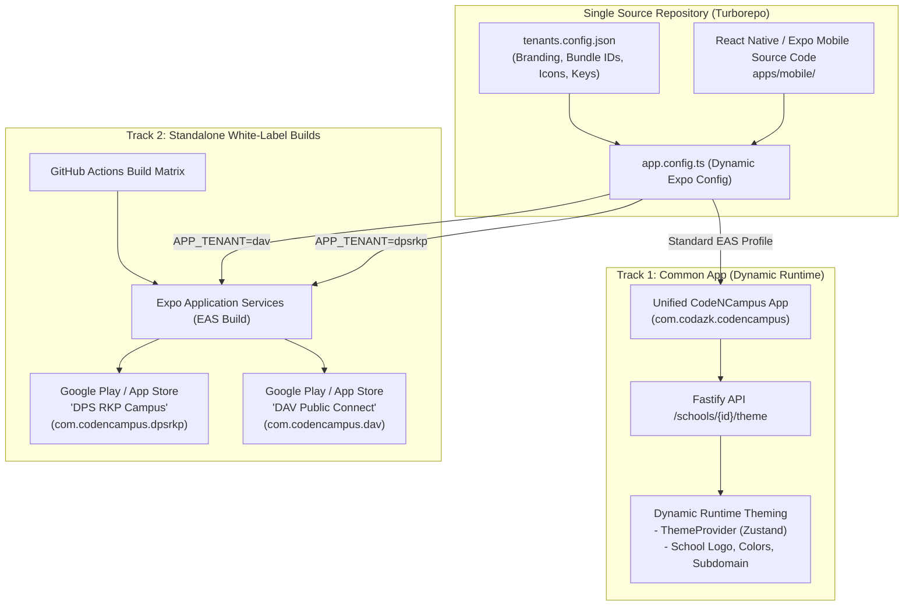

# CodeNCampus — White-Label Architecture & Build Pipeline

**Document Version:** 1.0.0  
**Status:** Under Architectural Review  
**Author:** Principal Mobile Engineer & DevOps Lead  
**Owner:** Codazk Technologies Private Limited

---

## 1. Dual-Track White-Label Strategy

Educational institutions have diverse commercial needs:

- **Tier 1 (Small / Mid-Size Schools):** Require low setup cost; happy using the **Unified CodeNCampus Mobile App** available on Google Play Store and Apple App Store, with dynamic runtime branding applied upon login.
- **Tier 2 (Premier Institutions & Large Chains):** Demand their own dedicated App Store / Google Play listings (e.g., "Delhi Public School Connect", package: `com.codencampus.dpsrkp`), custom splash screens, and dedicated app icons.

CodeNCampus fulfills both models from a **Single Source Codebase** through a two-pronged architectural strategy:



---

## 2. Dynamic Runtime Theming (Common Mobile App)

For the unified application, users download `CodeNCampus` from the stores. Once authenticated or upon entering their school code:

### 2.1 Server-Driven Branding Payload

When the app initializes or switches tenant, Fastify delivers:

```json
{
  "schoolId": "a1b2c3d4-e5f6-7890-abcd-ef1234567890",
  "name": "Delhi Public School, R.K. Puram",
  "code": "DPSRKP",
  "branding": {
    "logoUrl": "https://assets.codencampus.com/tenants/dpsrkp/branding/logo.png",
    "faviconUrl": "https://assets.codencampus.com/tenants/dpsrkp/branding/favicon.png",
    "primaryColor": "#0F5132",
    "secondaryColor": "#198754",
    "accentColor": "#D1E7DD",
    "fontFamily": "Inter"
  }
}
```

### 2.2 Client-Side Theme Provider (React Native)

```typescript
// apps/mobile/src/theme/ThemeProvider.tsx
import React, { createContext, useContext } from 'react';
import { useSessionStore } from '../store/sessionStore';

interface ThemeTokens {
  primary: string;
  secondary: string;
  accent: string;
  surface: string;
  text: string;
}

const ThemeContext = createContext<ThemeTokens>({
  primary: '#1E40AF',
  secondary: '#3B82F6',
  accent: '#DBEAFE',
  surface: '#FFFFFF',
  text: '#0F172A',
});

export const ThemeProvider: React.FC<{ children: React.ReactNode }> = ({ children }) => {
  const activeSchool = useSessionStore((state) => state.activeSchool);

  const theme: ThemeTokens = {
    primary: activeSchool?.branding?.primaryColor || '#1E40AF',
    secondary: activeSchool?.branding?.secondaryColor || '#3B82F6',
    accent: activeSchool?.branding?.accentColor || '#DBEAFE',
    surface: '#FFFFFF',
    text: '#0F172A',
  };

  return <ThemeContext.Provider value={theme}>{children}</ThemeContext.Provider>;
};

export const useTheme = () => useContext(ThemeContext);
```

---

## 3. Dedicated White-Label Store Builds (Expo Dynamic Configuration)

### 3.1 Operating System Boundary Reality

> [!IMPORTANT]
> An already-installed mobile application on iOS or Android **CANNOT** alter its bundle identifier (`com.foo.bar`), native app launcher name, or OS-level app icon at runtime via network requests.
> Creating independent Play Store and App Store listings requires generating distinct native binaries (`.aab` and `.ipa`) compiled with unique application identifiers and embedded asset catalogs.

### 3.2 Dynamic `app.config.ts` Architecture

Instead of maintaining separate mobile codebases, Expo’s TypeScript dynamic configuration compiles the source code according to the `APP_TENANT` environment variable:

```typescript
// apps/mobile/app.config.ts
import { ExpoConfig, ConfigContext } from "expo/config";
import fs from "fs";
import path from "path";

interface TenantConfig {
  name: string;
  slug: string;
  bundleIdentifier: string;
  package: string;
  icon: string;
  splash: {
    image: string;
    backgroundColor: string;
  };
  apiUrl: string;
  defaultSchoolCode?: string;
}

export default ({ config }: ConfigContext): ExpoConfig => {
  const tenantKey = process.env.APP_TENANT || "default";

  // Load white-label configuration registry
  const tenantsConfigPath = path.resolve(__dirname, "tenants.config.json");
  const tenantsData = JSON.parse(fs.readFileSync(tenantsConfigPath, "utf8"));
  const tenant: TenantConfig = tenantsData[tenantKey] || tenantsData.default;

  return {
    ...config,
    name: tenant.name,
    slug: tenant.slug,
    version: "1.0.0",
    orientation: "portrait",
    icon: tenant.icon,
    userInterfaceStyle: "light",
    splash: {
      image: tenant.splash.image,
      resizeMode: "contain",
      backgroundColor: tenant.splash.backgroundColor,
    },
    ios: {
      supportsTablet: true,
      bundleIdentifier: tenant.bundleIdentifier,
    },
    android: {
      adaptiveIcon: {
        foregroundImage: tenant.icon,
        backgroundColor: tenant.splash.backgroundColor,
      },
      package: tenant.package,
    },
    extra: {
      tenantKey,
      defaultSchoolCode: tenant.defaultSchoolCode,
      apiUrl: process.env.EXPO_PUBLIC_API_URL || "https://api.codencampus.com",
      eas: {
        projectId: process.env.EAS_PROJECT_ID,
      },
    },
  };
};
```

### 3.3 `tenants.config.json` Registry

```json
{
  "default": {
    "name": "CodeNCampus",
    "slug": "codencampus-app",
    "bundleIdentifier": "com.codazk.codencampus",
    "package": "com.codazk.codencampus",
    "icon": "./assets/branding/default/icon.png",
    "splash": {
      "image": "./assets/branding/default/splash.png",
      "backgroundColor": "#FFFFFF"
    }
  },
  "dpsrkp": {
    "name": "DPS R.K. Puram",
    "slug": "dps-rkp-campus",
    "bundleIdentifier": "com.codencampus.dpsrkp",
    "package": "com.codencampus.dpsrkp",
    "icon": "./assets/branding/dpsrkp/icon.png",
    "splash": {
      "image": "./assets/branding/dpsrkp/splash.png",
      "backgroundColor": "#0F5132"
    },
    "defaultSchoolCode": "DPSRKP"
  }
}
```

---

## 4. Automated Build Pipeline (Expo EAS + GitHub Actions)

Building white-label apps manually is unsustainable. CodeNCampus orchestrates an automated matrix build via `eas.json` and GitHub Actions:

```json
// apps/mobile/eas.json
{
  "cli": {
    "version": ">= 12.0.0"
  },
  "build": {
    "development": {
      "developmentClient": true,
      "distribution": "internal"
    },
    "preview": {
      "distribution": "internal"
    },
    "production-codencampus": {
      "env": {
        "APP_TENANT": "default"
      }
    },
    "production-dpsrkp": {
      "env": {
        "APP_TENANT": "dpsrkp"
      }
    }
  }
}
```

### 4.1 CI/CD Matrix Pipeline

A GitHub Actions workflow `.github/workflows/build-mobile.yml` executes builds in parallel when triggered via a release tag:

```yaml
name: Build White-Label Mobile Apps
on:
  workflow_dispatch:
    inputs:
      tenant:
        description: 'Tenant profile to build (or "all")'
        required: true
        default: "all"

jobs:
  build:
    runs-on: ubuntu-latest
    strategy:
      matrix:
        tenant: [default, dpsrkp]
    steps:
      - uses: actions/checkout@v4
      - uses: actions/setup-node@v4
        with:
          node-version: 20
      - run: npm install -g eas-cli
      - run: eas build --platform all --profile production-${{ matrix.tenant }} --non-interactive
        env:
          EXPO_TOKEN: ${{ secrets.EXPO_TOKEN }}
```

---

## 5. Web Portal Custom Domain & Branding Pipeline

For the Next.js web application:

1. **Dynamic Branding in Root Layout:**
   - Next.js Server Components extract the tenant from the `Host` header via Next.js Middleware.
   - The school's primary/secondary colors are injected directly into CSS custom properties (`--color-primary`, `--color-secondary`) at the `<html>` root level, enabling instant Tailwind theme alignment without recompilation.
2. **Custom SSL & Domain Management:**
   - Schools configure a CNAME: `school.org -> proxy.codencampus.com`.
   - Cloudflare for SaaS automatically issues a Let's Encrypt / Google Trust Services TLS certificate and handles end-to-end edge encryption.
